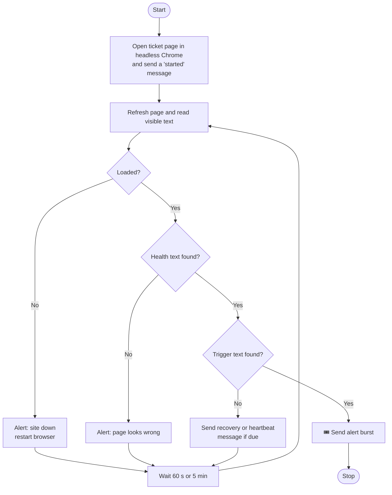

<div align="center">

# 🎟️ RCB Ticket Notifier

**Get an SMS and WhatsApp alert when Royal Challengers Bengaluru tickets go live.**


[Quick start](#-quick-start) •
[Configuration](#%EF%B8%8F-configuration) •
[How it works](#-how-it-works) •
[Troubleshooting](#-troubleshooting)

</div>

---

> [!NOTE]
> **💸 Everything in this repo is free. No credit card or paid subscription is needed to download, set up or try it.**
> Alerts go through [Twilio's free trial](#2-set-up-twilio-free-trial-available), which has [limits](#free-trial-limits) you should know about before relying on it.

IPL tickets can sell out quickly. This script keeps an eye on the [RCB ticket page](https://shop.royalchallengers.com/ticket) for you and sends a burst of alerts as soon as the tickets you are waiting for appears.

## ✨ Features

| | |
|---|---|
| 🔍 **Real browser checks** | Headless Chrome renders the page, so JavaScript content is visible |
| ⚡ **Two polling speeds** | Every 60 s during peak hours, every 5 min otherwise |
| 📲 **SMS + WhatsApp** | Sent through Twilio, to as many recipients as you configure |
| 🚨 **Alert bursts** | 10 alerts, 10 s apart, when tickets are detected |
| 🛠️ **Outage detection** | Warns you if the page fails to load or looks wrong, and when it recovers |
| 💓 **Heartbeat** | A "still running" message about every 6 hours |

## 🚀 Quick start

### Prerequisites

- Python 3.9 or newer
- Google Chrome (Selenium 4 downloads the matching ChromeDriver automatically)
- A [Twilio](https://www.twilio.com/try-twilio) account (the free trial works for getting started)
- A computer that [stays on](#-keep-it-running), or a cloud server

### 1. Clone and install

```bash
git clone https://github.com/charan-ravikumar/RCB-Ticket-Notifier.git
cd RCB-Ticket-Notifier

python3 -m venv .venv
source .venv/bin/activate        # Windows: .venv\Scripts\activate
pip install -r requirements.txt
```

### 2. Set up Twilio (free trial available)

🆓 **Twilio offers a free trial, and signing up needs no credit card.**

1. [Sign up](https://www.twilio.com/try-twilio) and verify your email and phone number.
2. Copy your **Account SID** and **Auth Token** from the Twilio Console.
3. Note the Twilio number to send SMS from.
4. Verify every phone number that should receive alerts. Your sign-up number is already verified.
5. *(Optional, for WhatsApp)* Join the [WhatsApp Sandbox](https://www.twilio.com/docs/whatsapp/sandbox) from the recipient's phone, and note the **Content SID** of a template that has a single variable, `{{1}}`.

#### Free trial limits

As listed in [Twilio's trial documentation](https://www.twilio.com/docs/usage/trials) in November 2026. Check it for current terms.

| Limit | Free trial |
|---|---|
| Duration | 30 days |
| Messages | 100 SMS and 100 WhatsApp |
| Recipients | Up to 5 verified numbers; SMS only within your sign-up country |
| Message text | Twilio's pre-defined templates only |

> [!WARNING]
> This bot writes its own SMS text, so a trial account may reject its SMS alerts. WhatsApp alerts need a template that your trial allows. Check the terminal for `✅ ... sent` or `❌ ... failed` when the bot starts, and confirm the message reaches your phone. Custom messages require an upgraded (paid) Twilio account, which is optional and your choice.

### 3. Fill in the required values

Create your private settings file:

```bash
cp .env.example .env
```

Open `.env` and replace the placeholders. **These values are required:**

| Value | Where to get it |
|---|---|
| `TRIGGER_TEXTS` | Text that will appear on the ticket page when your match goes on sale |
| `RECIPIENT_1_PHONE` | The number to alert, with country code |
| `RECIPIENT_1_ACCOUNT_SID` | Twilio Console |
| `RECIPIENT_1_AUTH_TOKEN` | Twilio Console |
| `RECIPIENT_1_SMS_FROM` | Your Twilio number |

Also set `MATCH_NAME` and check `HEALTH_CHECKS` for your match.

#### 📝 Example: RCB vs CSK on 5 April 2026

```ini
# What to watch
MATCH_NAME="RCB vs CSK (Apr 5)"
TRIGGER_TEXTS="SUN, APR 5|APRIL 5, 2026|CHENNAI SUPER KINGS"
HEALTH_CHECKS="BUY TICKETS|TICKETS NOT AVAILABLE"

# Who to alert (all values below are made up)
RECIPIENT_1_PHONE=+919876543210
RECIPIENT_1_ACCOUNT_SID=ACxxxxxxxxxxxxxxxxxxxxxxxxxxxxxxxx
RECIPIENT_1_AUTH_TOKEN=your_auth_token_here
RECIPIENT_1_SMS_FROM=+15551234567

# Optional: WhatsApp
RECIPIENT_1_WA_CONTENT_SID=HXxxxxxxxxxxxxxxxxxxxxxxxxxxxxxxxx
RECIPIENT_1_WA_FROM=+14155238886
```

For another match, change the name, date and opponent. Separate multiple texts with `|`. Any **one** trigger is enough to fire the alert.

### 4. Run

```bash
python rcb_ticket_notifier.py
```

A "started" message is sent to each recipient. Press `Ctrl+C` to stop.

## 🔁 Keep it running

> [!IMPORTANT]
> **The bot only works while the script is running.** Your laptop or computer must stay on, awake and connected to the internet the whole time. If it sleeps, shuts down or goes offline, checks stop and you can miss the tickets.

- **On your own computer:** turn off automatic sleep and keep it plugged in. On macOS, this keeps it awake while the bot runs:

  ```bash
  caffeinate -i python rcb_ticket_notifier.py
  ```

- **On a cloud service:** you can instead deploy it to any cloud server that runs Python and Chrome, such as AWS, Google Cloud, Azure or Oracle Cloud. Use `tmux`, `systemd` or similar so it keeps running after you disconnect. Cloud providers set their own terms, and many ask for a credit card or charge for usage, even where a free tier exists.

## ⚙️ Configuration

### Environment variables (`.env`)

| Variable | Required | Description |
|---|:---:|---|
| `TRIGGER_TEXTS` | ✅ | `\|`-separated texts that mean tickets are live |
| `MATCH_NAME` | | Match name used in alert messages |
| `HEALTH_CHECKS` | | `\|`-separated texts that show the page loaded properly |
| `TICKET_URL` | | Page to watch |
| `RECIPIENT_1_PHONE` | ✅ | Number to alert, with country code |
| `RECIPIENT_1_ACCOUNT_SID` | ✅ | Twilio Account SID |
| `RECIPIENT_1_AUTH_TOKEN` | ✅ | Twilio Auth Token |
| `RECIPIENT_1_SMS_FROM` | ✅ | Your Twilio SMS number |
| `RECIPIENT_1_WA_CONTENT_SID` | | Enables WhatsApp for this recipient |
| `RECIPIENT_1_WA_FROM` | | WhatsApp sender (defaults to the sandbox number) |
| `RECIPIENT_1_WA_ACCOUNT_SID` / `_WA_AUTH_TOKEN` | | Only if WhatsApp uses another Twilio account |

Add more people with `RECIPIENT_2_*`, `RECIPIENT_3_*` and so on. Numbering must have no gaps.

> [!IMPORTANT]
> **Choose triggers carefully.** Matching is a simple case-insensitive substring search. Use text that appears *only* when your match is on sale, such as its date or the opponent's name. Broad entries like `APR` or `BUY TICKETS` will fire on other matches.
>
> **Keep health checks current.** At least one must always be on a working page, even after your tickets appear. Otherwise the page is reported as broken and triggers are ignored.

### Timing (top of `rcb_ticket_notifier.py`)

| Setting | Default | Meaning |
|---|---|---|
| `PEAK_INTERVAL` | `60` s | Delay between checks in peak hours |
| `NORMAL_INTERVAL` | `300` s | Delay between checks otherwise |
| `PEAK_START` / `PEAK_END` | `07:00` / `23:59` | Peak window, in local time |
| `NUM_ALERTS` | `10` | Alerts per burst |
| `ALERT_GAP` | `10` s | Delay between alerts in a burst |
| `HEARTBEAT_EVERY` | `6` h | Delay between status messages |

## 🧠 How it works



- The **first** failure triggers a burst of up to 10 alerts, which stops early if the page recovers. While it stays down, you get one alert per check.
- Once tickets are detected, the script sends its burst and **exits**. Restart it to watch for another match.

## 📁 Project structure

```
.
├── rcb_ticket_notifier.py   # The notifier: run this
├── find_api_endpoints.py    # Optional developer helper
├── .env.example             # Configuration template
├── requirements.txt         # Python dependencies
└── README.md
```

### 🧪 What is `find_api_endpoints.py`?

An exploration tool, **not** needed to receive alerts. It:

1. Downloads the HTML of the ticket page.
2. Finds the site's main JavaScript bundle (`/assets/index-*.js`).
3. Prints every URL embedded in that bundle.
4. Highlights those containing words such as `ticket`, `match`, `event` or `api`.

The goal is to discover a backend API that could be polled directly, which would be faster and lighter than driving a browser.

```bash
python find_api_endpoints.py
```

## 🩺 Troubleshooting

| Problem | What to check |
|---|---|
| `No recipients configured` | `.env` exists and has `RECIPIENT_1_PHONE` |
| SMS fails | Credentials, number format, and trial-account verification |
| WhatsApp fails | The recipient has joined the sandbox (membership expires) and the Content SID belongs to that account |
| Constant "health check failed" | Update `HEALTH_CHECKS` to text currently on the page |
| Alert fires immediately | A trigger is too broad |
| Chrome does not start | Install or update Google Chrome |

## ⚠️ Good to know

- Detection depends on the page's wording, so a site redesign can break it.
- Alerts use up Twilio message units. With two recipients on SMS and WhatsApp, one burst is 40 messages, and paid accounts are charged once free units run out.
- This script only notifies you. It does not book tickets.
- Check the website's terms of use and keep the polling interval reasonable.

## 🔒 Security

Credentials and phone numbers belong in `.env`, which git ignores. If a token is ever exposed, rotate it in the Twilio Console.

---

<div align="center">

*An unofficial fan project, not affiliated with Royal Challengers Bengaluru, the IPL or Twilio.*

**Ee Sala Cup Namde! 🔴⚫**

</div>
